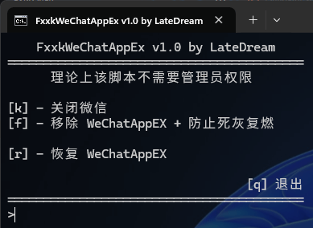

### FxxkWeChatAppEx
**一键告别 WeChatAppEX**

> [!IMPORTANT]
> 某信从新版本（具体版本未知，可能为 3.9 ~ 4.0）开始  
> 部分功能（目前已知[公众号相关功能](https://github.com/DreamLateXD/FxxkWeChatAppEx/issues/2)受影响）已完全依赖 WeChatAppEx  
> 若你需要使用这些功能则不要移除该组件  

支持命令提示符（旧版），PowerShell 5.1/7+

### ⚡ 快速开始
直接在 PowerShell 中运行这条命令即可使用：
```sh
irm https://raw.githubusercontent.com/DreamLateXD/FxxkWeChatAppEx/refs/tags/2.0/FxxkWeChatAppEx.ps1 | iex
```

若你想使用 cmd 版（旧版）则需手动[下载](https://github.com/DreamLateXD/FxxkWeChatAppEx/releases/tag/1.0)后运行。

<br>


